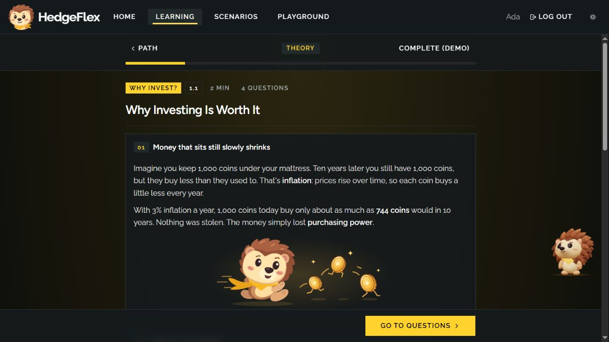
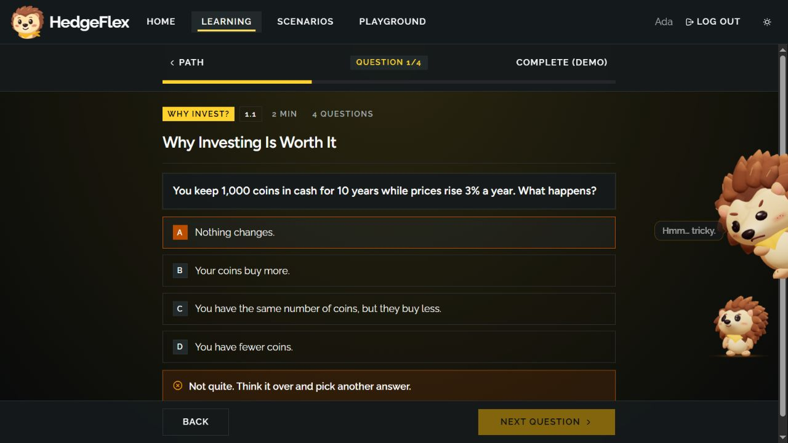
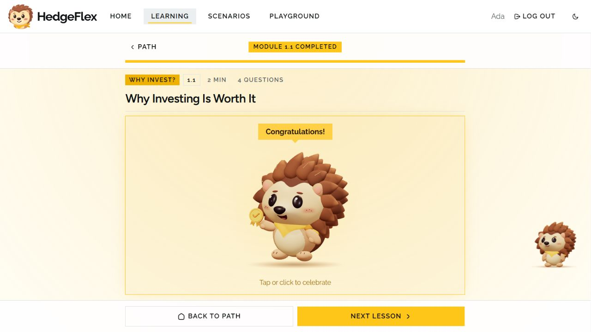

# HedgeFlex

<p align="center">
  <a href="docs/media/hedgie-wave.glb"></a>
  <br>
  <strong>Meet Hedgie, your investing coach.</strong>
  <br>
  <a href="docs/media/hedgie-wave.glb">Get the animated 3D model (.glb)</a>
</p>

HedgeFlex is a team-built investing game for beginners. Learn a concept in a short lesson, then put it to work with virtual money. Hedgie gives you a hint when a question trips you up and can walk you through the results of your investment plan.

## Try a scenario

Marek has €25,000, six years and a favourite chip company. How much would you put into that one stock? Build his portfolio, watch the simulated market play out, then see which decisions earned each star. Pick **Change plan** to try a different allocation on the same market.


## Learn and experiment

Follow 19 lessons across three chapters. The first lesson starts with 1,000 coins under a mattress. Ten years later, the coins are still there. What can they buy?

| The learning path | Inside the first lesson · dark mode |
| --- | --- |
|  |  |

Pick “Nothing changes” and Hedgie peeks in from the edge of the screen. You can try another answer right away.



Finish the four exercises and Hedgie celebrates with a medal.



For a free-form experiment, the **Playground** gives you €10,000 to trade across 12 stocks and 8 ETFs during a simulated market replay.

## Run locally

Install **JDK 25** and **Node.js 24** with npm. Open two terminals in the repository root. On Windows, use Git Bash for the backend command.

**Terminal 1 · Spring Boot API**

```sh
cd backend
bash mvnw spring-boot:run
```

**Terminal 2 · React frontend**

```sh
cd frontend
npm ci
npm run dev
```

Open [localhost:5173](http://localhost:5173), select **Log in → Continue as guest**, and enter a display name and a demo email such as `ada@example.com`. The backend loads the lessons and scenarios into an in-memory H2 database on startup.

To enable Hedgie’s AI replies, set `OPENAI_API_KEY` in the backend terminal before starting Spring Boot. Lessons, scenarios and the Playground work without a key.
